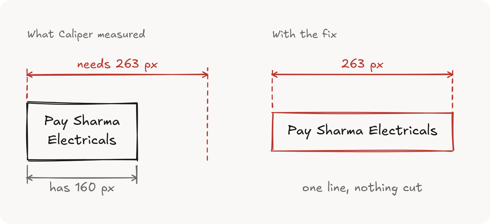
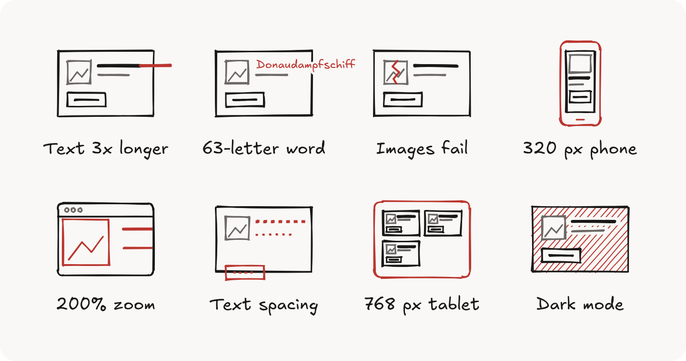
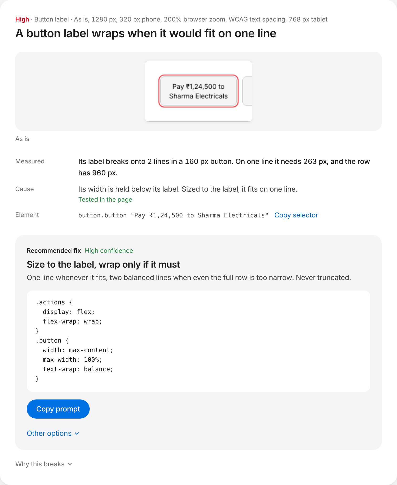

# Caliper

[](https://www.npmjs.com/package/caliper-check)
[](https://github.com/Arul-Raaj/caliper/blob/main/LICENSE)
[](https://nodejs.org)

Caliper opens your page in a real browser, feeds it the content real users bring, and shows you what breaks. Every issue comes with a screenshot, the measurement that proves it, and the CSS that fixes it.

```sh
npx caliper-check https://your-site.com
```

It works on anything with a URL: a live site, a preview deploy, or `http://localhost:3000`.

<picture>
  <source media="(prefers-color-scheme: dark)" srcset="https://raw.githubusercontent.com/Arul-Raaj/caliper/main/docs/measure-dark.png">
  
</picture>

## What it does

Caliper runs the page as is, then pushes it eight ways: text three times longer, a 63-letter word, broken images, a 320 px phone, 200% zoom, WCAG text spacing, a 768 px tablet and dark mode.

<picture>
  <source media="(prefers-color-scheme: dark)" srcset="https://raw.githubusercontent.com/Arul-Raaj/caliper/main/docs/stress-dark.png">
  
</picture>

It also opens menus and sheets, hovers rows and presses Tab, so what only appears after a click gets measured too.

It measures every element and reports sideways scrolling, text that spills or gets cut off, flex and grid items that won't shrink, fixed heights, stretched or missing images, small tap targets, button labels that wrap or truncate, and fixed panels that run off screen. It also catches the defects AI-built UI tends to ship with: scrollbars over content, controls pushed out of their container, hover fills that hug their content, tooltips off the side of the screen, no visible focus ring, words split mid-way, and images that vanish into their background.

Each issue gets a fix chosen for the element: a title clamps at two lines, a button label never truncates, a price never breaks. Two alternatives and a "Copy prompt" button for your AI assistant sit beside it. Caliper itself uses no AI, so the same page gives the same report every time.

<picture>
  <source media="(prefers-color-scheme: dark)" srcset="https://raw.githubusercontent.com/Arul-Raaj/caliper/main/docs/report-dark.png">
  
</picture>

## Options

```sh
npx caliper-check <url> --only narrow,long-text   # run some scenarios
npx caliper-check <url> --width 400               # also test a side panel width
npx caliper-check <url> --steps states.json       # also measure scripted states
npx caliper-check <url> --no-interact             # don't open, hover or tab
npx caliper-check <url> --ignore ".ticker"        # leave elements out
npx caliper-check <url> --out ./reports/home      # choose the folder
npx caliper-check <url> --no-fail                 # always exit 0
```

Caliper finds menus, sheets and accordions by their `aria-haspopup`, `aria-expanded` and `<details>`. It only clicks those, never ordinary buttons or links. For a state behind other clicks, list the steps in a JSON file. Each state starts from a fresh page:

```json
[{ "name": "Deep Dive", "steps": [{ "click": ".mode" }, { "click": ".deep" }, { "wait": 200 }] }]
```

A step is one of `click`, `hover`, `fill` (with `value`), `press`, `waitFor` or `wait`. A step that can't run makes the run partial, so it never reads as clean. `--no-interact` leaves scripted states running.

Add `data-caliper-ignore` to leave an element out from your own markup. The report is written to `caliper-report/index.html`, with the same findings in `report.json`.

Caliper exits with `1` when it finds issues, so CI can fail on them, `0` when the page holds up, and `2` on an error or a run that couldn't finish. A partial run never looks like a clean one.

Requires Node 22.18 or newer. The first run downloads the browser Caliper drives (about 300 MB, once). After that, a page takes 10 to 40 seconds.

## Licence

MIT
